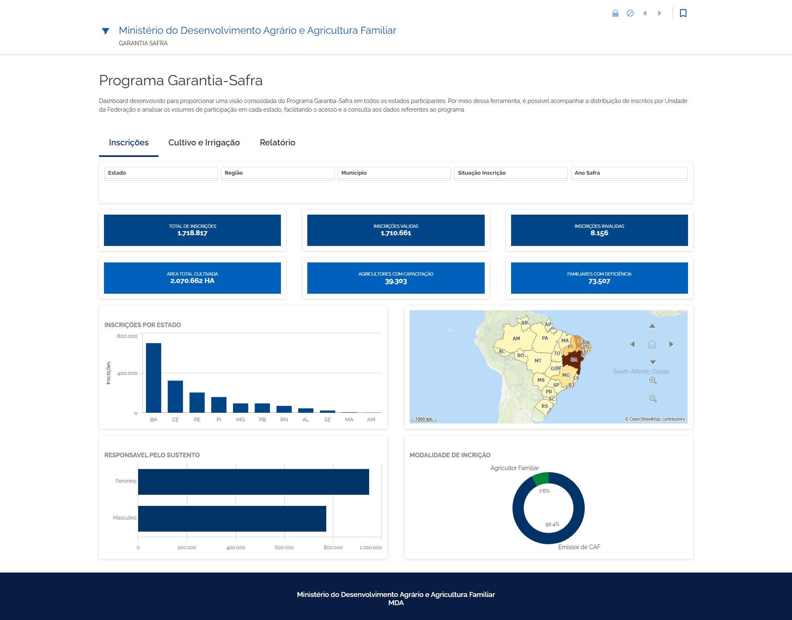
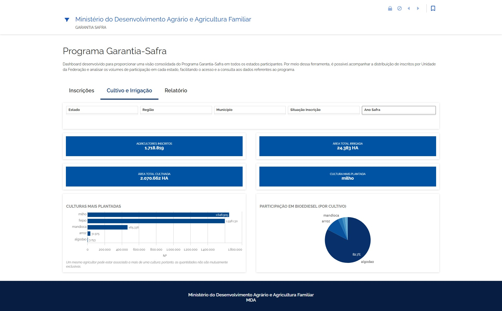
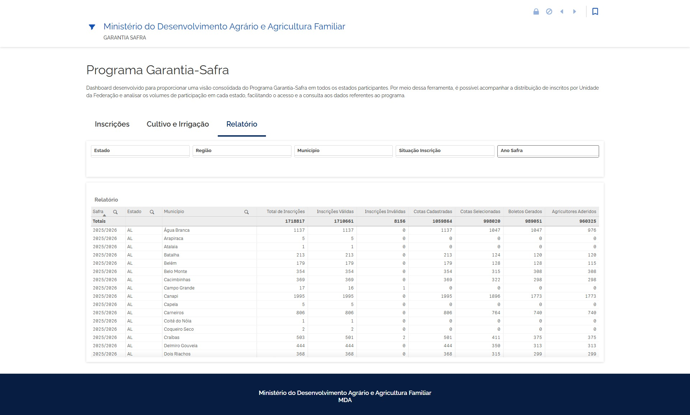
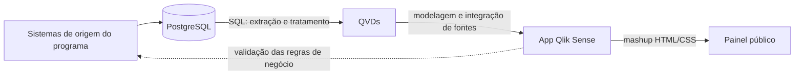

# Painéis públicos de políticas agrárias – Ministério do Desenvolvimento Agrário

Portfólio dos painéis de Business Intelligence em que atuei como estagiária de Análise de Dados na Coordenação-Geral de Tecnologia da Informação (CGTI) do Ministério do Desenvolvimento Agrário e Agricultura Familiar (MDA).

> Este repositório reúne apenas material público: links, capturas de tela de painéis abertos à população e a descrição do meu trabalho. Não contém código, consultas, estruturas de banco ou dados internos do Ministério.

---

## Painel do Programa Garantia-Safra

**Acesse o painel:** [mapa-indicadores.agricultura.gov.br – Garantia-Safra](https://mapa-indicadores.agricultura.gov.br/publico/extensions/MASHUP_GS_CGTI/MASHUP_GS_CGTI.html)

O Garantia-Safra funciona como um seguro para agricultores familiares de baixa renda que perdem a produção por seca ou excesso de chuvas. O painel dá uma visão consolidada do programa em todos os estados participantes e permite a qualquer cidadão ou gestor acompanhar inscrições, cultivo e participação por estado e município.

**Escala:** mais de 1,7 milhão de inscrições e cerca de 2 milhões de hectares cultivados, com filtros por estado, região, município, situação da inscrição e ano-safra.

### Inscrições
Indicadores de inscrições totais, válidas e inválidas, área cultivada, agricultores com capacitação e familiares com deficiência; inscrições por estado (gráfico e mapa), responsável pelo sustento e modalidade de inscrição.

### Cultivo e Irrigação
Agricultores inscritos, área total irrigada e cultivada, cultura mais plantada, ranking de culturas e participação em biodiesel por cultivo.

### Relatório
Tabela detalhada por safra, estado e município, com inscrições, cotas cadastradas e selecionadas, boletos gerados e agricultores aderidos.

### Meu papel

O painel foi desenvolvido em colaboração com outro profissional da equipe de tecnologia do Ministério, com divisão entre as demandas de dados e de desenvolvimento. Minha atuação:

- Extração, consulta e tratamento dos dados com SQL em PostgreSQL.
- Organização e modelagem dos dados para consumo no Qlik Sense, com QVDs e integração de diferentes fontes.
- Desenvolvimento dos indicadores e das visualizações gerenciais.
- Validação das regras de negócio e da consistência das informações entre as bases e os sistemas de origem.
- Participação na disponibilização do painel para consulta pública, como mashup do Qlik Sense, incluindo customizações de layout em HTML e CSS.

### Fluxo de dados

### O que aprendi

Um número "errado" num painel quase nunca é erro de fórmula. Na maioria das vezes, o sistema de origem aplica uma regra que o banco não reflete, ou o banco guarda um dado cuja origem ninguém lembra mais. Por isso, boa parte do trabalho foi conversar com as equipes de gestão e de desenvolvimento para validar cada indicador antes da publicação.

---

## Outros projetos de BI no MDA

- **Cadastro Nacional da Agricultura Familiar (CAF e CAF 3.0):** painéis analíticos sobre uma base com mais de 4 milhões de registros, com monitoramento das situações cadastrais, perfil demográfico, distribuição geográfica e evolução das inscrições, seguindo as diretrizes do Padrão Digital de Governo.
- Painéis para a Vitrine, os contratos do Ministério, a Ouvidoria (Fala.BR) e coordenações internas.

## Ferramentas

SQL · PostgreSQL · DBeaver · Qlik Sense (QVD, modelagem, mashups) · Power BI · HTML/CSS

## Autora

Giovana Fontoura · [LinkedIn](https://www.linkedin.com/in/giovana-fontoura/) · [GitHub](https://github.com/gifontoura)
